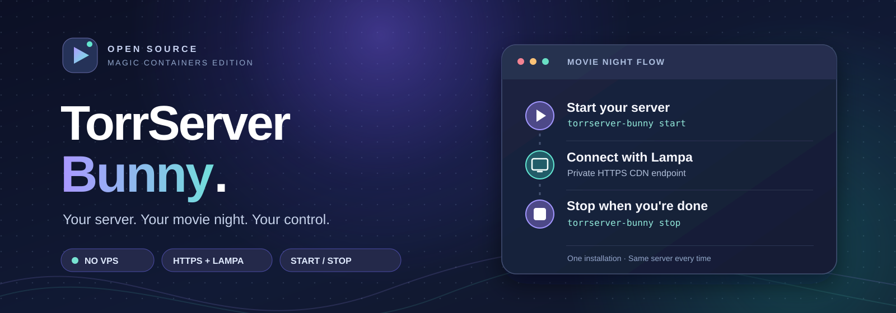

<div align="center">



<br />

**A self-hosted TorrServer experience without renting a VPS.**  
Deploy on [bunny.net Magic Containers](https://bunny.net/magic-containers/), connect with Lampa, and control when the server runs.

<br />

<a href="https://github.com/vbrekher/TorrServer-bunny/actions/workflows/bunny-cli-tests.yml"></a>
<a href="LICENSE"></a>


<br /><br />

**[Quick start](#-get-started)** &nbsp;·&nbsp; **[Connect Lampa](#-connect-to-lampa)** &nbsp;·&nbsp; **[Pricing](#-what-does-a-50-gb-movie-cost)** &nbsp;·&nbsp; **[Documentation](#-documentation)**

</div>

---

## 🌍 Documentation

<div align="center">

| 🇷🇺 **Русский** | 🇬🇧 **English** | 🇳🇱 **Nederlands** |
| :---: | :---: | :---: |
| **[Руководство пользователя →](docs/README.ru.md)** | **[User guide →](docs/README.en.md)** | **[Gebruikershandleiding →](docs/README.nl.md)** |
| Установка · Lampa · Цены | Setup · Lampa · Pricing | Installatie · Lampa · Kosten |

</div>

## A personal streaming server, on your terms.

TorrServer Bunny is a deployment and control layer built around the open-source **[TorrServer by YouROK](https://github.com/YouROK/TorrServer)**. Instead of maintaining a 24/7 VPS, you use a container on Bunny, a private HTTPS CDN address, and three simple terminal commands to manage it.

<table>
<tr>
<td width="33%" valign="top">

### ☁️ No VPS to manage

Runs in **Bunny Magic Containers**. Select one region; the installer handles the container, credentials and HTTPS endpoint.

</td>
<td width="33%" valign="top">

### 📺 Built for Lampa

Copy the **HTTPS CDN domain** into Lampa's TorrServer settings. Your account gets its own login and generated password.

</td>
<td width="33%" valign="top">

### ⏻ Start & stop on demand

Stop compute after a film. Start the **same application** again later, with its persistent configuration intact.

</td>
</tr>
<tr>
<td width="33%" valign="top">

### 🔒 Access controlled

TorrServer login credentials are saved locally. The HTTPS endpoint uses authentication; the Bunny API key stays out of the container.

</td>
<td width="33%" valign="top">

### 🧩 Optional peer networking

Enable a separately billed **Anycast IPv4** endpoint for inbound BitTorrent TCP/UDP connections.

</td>
<td width="33%" valign="top">

### 🕒 Optional idle watchdog

A scheduled GitHub Action can request a stop after **60+ minutes** without media activity. Best effort, not a guaranteed timer.

</td>
</tr>
</table>

## 🚀 Get started

<sub>**FIRST-TIME SETUP · macOS / Linux · Python 3 + curl · Bunny account required**</sub>

**1. Open Terminal** on your Mac or Linux computer. Copy and run:

```bash
curl -fsSL --retry 3 \
  https://raw.githubusercontent.com/vbrekher/TorrServer-bunny/master/install-bunny.sh \
  -o /tmp/install-torrserver-bunny.sh \
  && sh /tmp/install-torrserver-bunny.sh
```

**2. Answer the guided setup questions.** The wizard will ask for your private Bunny account API key, region (for example `AMS` or `DE`), a username and whether you want the *optional paid* Anycast peer port. It generates a password automatically. Type **`CREATE` once** to approve billable resources.

**3. Get your private server address.** After provisioning, run `status` and look for the **HTTPS CDN URL**. A valid *example* looks like `https://mc-example.bunny.run`. Use **your own address**, not this example.

> [!IMPORTANT]
> Setup creates **paid Bunny resources**. If you already have an app, do **not** run the setup wizard again. Go straight to the daily commands below.

### Your everyday commands

<table>
<tr><th>Action</th><th>Command</th><th>What happens</th></tr>
<tr><td>🟢 <b>Start</b></td><td><code>~/.local/bin/torrserver-bunny start</code></td><td>Deploys your existing server</td></tr>
<tr><td>🔍 <b>Status</b></td><td><code>~/.local/bin/torrserver-bunny status</code></td><td>Checks Bunny status and HTTPS URL</td></tr>
<tr><td>🔴 <b>Stop</b></td><td><code>~/.local/bin/torrserver-bunny stop</code></td><td>Stops running containers, not the saved app</td></tr>
</table>

Starting and stopping are **asynchronous**. Wait for `active` in `status` before expecting the stream to work. Opening Lampa **will not** automatically start a stopped container.

## 📺 Connect to Lampa

<table>
<tr><td><b>1. Find the HTTPS URL</b></td><td>Run <code>~/.local/bin/torrserver-bunny status</code> and copy the line <code>TorrServer HTTPS CDN URL</code>.</td></tr>
<tr><td><b>2. Retrieve credentials privately</b></td><td>Run <code>~/.local/bin/torrserver-bunny status --show-credentials</code> on your own computer.</td></tr>
<tr><td><b>3. Configure Lampa</b></td><td>Open <b>Lampa → Settings → TorrServer</b> and enter the HTTPS CDN domain, username and password. Menu names may vary.</td></tr>
<tr><td><b>4. Try a test stream</b></td><td>Test with a torrent that you are allowed to download and share. TV codec and torrent peer compatibility require real testing.</td></tr>
</table>

> [!WARNING]
> **Do not use an Anycast IP ending in `:32000` as your Lampa server URL.** That is a BitTorrent peer port, not the HTTPS web endpoint. For Lampa, use the **HTTPS CDN domain** returned by `status`.

## 💸 What does a 50 GB movie cost?

An **illustrative Blu-ray-size movie** streamed over **3 hours** to one viewer in Europe / North America, assuming **one fully utilized CPU core** and **1 GB of billed RAM** for that period:

| Usage | Calculation | Example |
| :--- | ---: | ---: |
| 📡 50 GB outgoing video traffic | 50 × $0.01/GB | **$0.50** |
| ⚙️ CPU for 3 hours | 3 × $0.02/core-hour | **$0.06** |
| 🧠 RAM for 3 hours | 3 × $0.005/GB-hour | **$0.015** |
| **Estimated session subtotal** | **Network + assumed compute** | **≈ $0.58** |
| 💾 Persistent 1 GB configuration volume | Monthly allocation | **≈ $0.10 / month** |
| 🌐 Optional Anycast IPv4 | Full-month allocation | **≈ $2 / month** |

**One such movie in a 30-day month, with resources retained all month:**

| Configuration | Illustrative total |
| :--- | ---: |
| Without Anycast IP | **≈ $0.68 / month** |
| With an allocated Anycast IPv4 | **≈ $2.68 / month** |

<sub>**This is not a guaranteed bill.** The session estimate excludes BitTorrent peer upload / seeding (potentially significant), extra or repeated traffic, additional applicable CDN charges, region-specific prices, taxes, other Bunny products and account minimums. CPU and RAM usage are assumptions, not measurements. `stop` stops compute, but allocated storage and Anycast can remain billable. Bunny rates and billing may change. Rates referenced as of **2 November 2026**: [Magic Containers](https://bunny.net/magic-containers/) · [CDN pricing](https://bunny.net/pricing/cdn/).</sub>

## 🕒 Automatic shutdown after 60 idle minutes

**Start the server → watch a movie in Lampa → stop playback → let GitHub Actions shut down the idle container.** The timer starts from the **last tracked video activity**, not from server startup. No extra software needs to stay running on your Mac after setup.

**Simple instructions in your language:**

| 🇷🇺 Русский | 🇬🇧 English | 🇳🇱 Nederlands |
| :---: | :---: | :---: |
| **[Автоотключение за 4 шага](docs/README.ru.md#6-автоотключение-через-60-минут--простая-инструкция)** | **[4 steps to auto-stop](docs/README.en.md#6-auto-stop-after-60-idle-minutes--easy-guide)** | **[Automatisch stoppen in 4 stappen](docs/README.nl.md#6-automatisch-stoppen-na-60-minuten--eenvoudige-uitleg)** |

### First-time setup (do this once)

**1.** Install and sign in to [GitHub CLI](https://cli.github.com/) (`gh`); use **a GitHub repository you own** containing `.github/workflows/idle-watchdog.yml` (fork this repository if necessary). Do not give your Bunny API key to a repository owned by someone else.

**2.** Start your existing Bunny app, play a short video in Lampa and check that the gateway has counted real media data:

```bash
~/.local/bin/torrserver-bunny activity
```

`Tracked media bytes since container startup` must be **greater than 0**. If it is `0`, auto-stop must remain off; play a test stream since the current container startup and recheck.

**3.** Enable the scheduled watchdog on your **own GitHub repository**:

```bash
REPO="YOUR_USERNAME/TorrServer-bunny" # Replace with your own GitHub repo
gh auth status
~/.local/bin/torrserver-bunny enable-github-watchdog --repo "$REPO"
# Enter ENABLE when prompted. Continue ONLY if "Secrets installed" appears.
gh workflow enable idle-watchdog.yml -R "$REPO"
gh workflow run idle-watchdog.yml -R "$REPO"
```

The CLI securely sets four GitHub Actions repository secrets from your local configuration; **do not paste secrets into README or GitHub source files**. The manual workflow run is a connectivity check, not a forced shutdown.

**4.** After playback ends, leave the Bunny app running and avoid streaming for **60 minutes or more**. Check the result:

```bash
gh run list --workflow idle-watchdog.yml -R "$REPO" -L 10
~/.local/bin/torrserver-bunny status
```

The log line `IDLE_STOP_REQUESTED` means shutdown was requested; `State: inactive` confirms Bunny actually stopped. A green GitHub Actions run can simply mean that the stop condition was not met. When Bunny is already inactive, the updated watchdog logs `ALREADY_INACTIVE` and exits without another stop. For noninteractive logs, pass the run ID: `gh run view RUN_ID -R "$REPO" --log`.

> [!IMPORTANT]
> GitHub checks approximately every **10 minutes**, but scheduled runs may be delayed or skipped: **this is not a guaranteed 60:00 timer**. If no video has been tracked since this container started, the safety rule will *not* stop it automatically; use `~/.local/bin/torrserver-bunny stop`. Lampa cannot restart a stopped container by itself. Persistent storage and allocated Anycast IP can still cost money. **Real-world idle auto-stop verified on 4 Nov 2026: GitHub Actions run [#41920393921](https://github.com/vbrekher/TorrServer-bunny/actions/runs/41920393921) logged `idle_minutes=91` and `IDLE_STOP_REQUESTED`; the owner confirmed Bunny `State: inactive`.**

<details>
<summary><strong>🔧 Advanced troubleshooting and useful commands</strong></summary>

<br />

| Situation | What to do |
| --- | --- |
| Already installed | Use `start`, `status` and `stop` — **not** `setup`. |
| Need your password | `~/.local/bin/torrserver-bunny status --show-credentials` (keep output private). |
| No HTTPS domain yet | Check `torrserver-https` under **Magic Containers → Endpoints** in Bunny. Do not create another app. |
| Wrong IP address appears | Update the CLI and run `status`; use the HTTPS CDN **domain**, not Anycast port `32000`. |
| Creation returned HTTP 500 | Do not retry `CREATE` blindly; run `~/.local/bin/torrserver-bunny doctor` and check your Bunny dashboard. |
| Update the CLI without creating a server | Run the installer with the `status` argument (see below). |

```bash
curl -fsSL --retry 3 \
  https://raw.githubusercontent.com/vbrekher/TorrServer-bunny/master/install-bunny.sh \
  -o /tmp/install-torrserver-bunny.sh \
  && sh /tmp/install-torrserver-bunny.sh status
```

More detail: **[Technical deployment guide](bunny/README.md)**.

</details>

## ✅ Project status

| Capability | Verification |
| --- | --- |
| Real Magic Containers app created | ✅ Confirmed from owner deployment on 2 November 2026 |
| Application `active`, HTTPS CDN URL received | ✅ Confirmed from Bunny API output |
| Python CLI and Go gateway | ✅ Automated tests in [GitHub Actions](https://github.com/vbrekher/TorrServer-bunny/actions/workflows/bunny-cli-tests.yml) |
| Streaming through Lampa | ✅ Playback confirmed by the project owner (4 Nov 2026); physical-device compatibility has not been independently audited |
| Scheduled 60-minute shutdown on live Bunny | ✅ Verified: 91 idle minutes → stop requested → owner saw `inactive` ([GitHub run](https://github.com/vbrekher/TorrServer-bunny/actions/runs/41920393921)) |

**Verification boundary:** Lampa streaming is now **owner-confirmed** (4 Nov 2026). It is not an independent compatibility certification for every Samsung/Tizen device or format. A real 60-minute idle shutdown **has been verified**: GitHub requested undeploy after 91 tracked idle minutes, and the owner observed the container inactive. GitHub cron scheduling remains best-effort; one live pass does not guarantee every future scheduled run. This project does not provide or distribute movies, catalogs or copyrighted material.

## ❤️ Built on open source

<div align="center">

**A big thank-you to [YouROK and all contributors to TorrServer](https://github.com/YouROK/TorrServer).**

TorrServer Bunny is an independent deployment and lifecycle layer built around their work. The original torrent engine, its upstream community and its license deserve clear recognition.

[Original TorrServer](https://github.com/YouROK/TorrServer) · [Lampa](https://github.com/yumata/lampa) · [Technical guide](bunny/README.md) · [GPL-3.0 License](LICENSE)

<sub>Use only content you are legally entitled to access and share. This repository does not host any films or torrent catalog.</sub>

</div>
